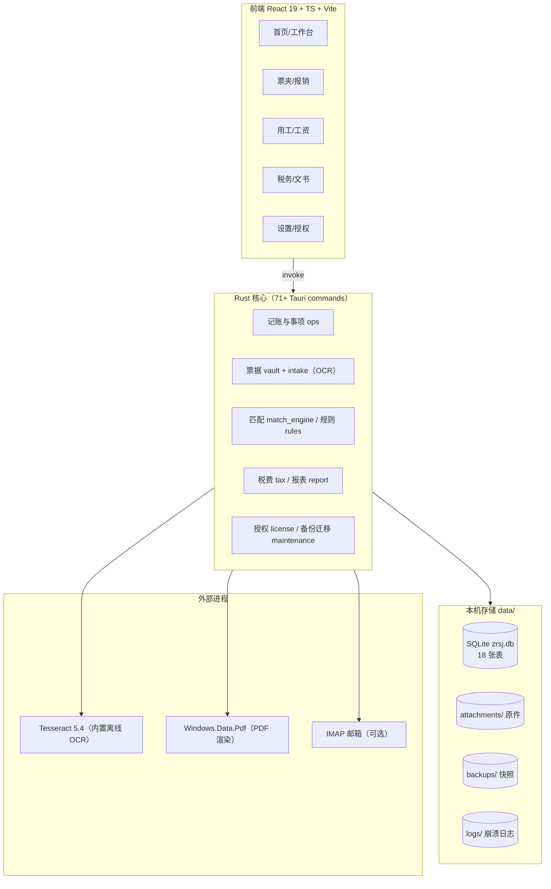

# 自然拾光记账 · 产品与技术现状

> 最后更新：2026-10-26 ｜ 适用版本：0.1.0（v37）
> 本文是**唯一权威现状说明**。`docs/技术方案.md` 是 2026-10-11 的开工方案（历史文档），若与本文冲突，以本文为准。

---

## 1. 产品定位

面向**个体工商户 / 小微企业主 / 自由职业者**的单机记账与报税辅助工具。

- **单用户、单账套**：一个软件实例对应一家公司（`company` 表仅一行）。
- **本地优先**：账套、票据原件、备份全部在本机，不上传服务器。
- **不含云端**：无账号系统、无多端同步、无在线校验；授权为离线授权码。
- **不做代理申报**：只做申报数据准备与打印，不代替客户报送（无需代理记账资质）。

这是刻意的取舍：先把「一个人用一台电脑」这条主线做扎实，再谈联网。

---

## 2. 技术架构



| 层 | 技术 | 说明 |
|----|------|------|
| 桌面壳 | Tauri 2.x | 单窗口，自绘标题栏，圆角 + 浅色毛玻璃 |
| 前端 | React 19 + TS 5 + Vite | 8 个页面组件，无重型组件库 |
| 后端 | Rust 2024 edition | 业务全部在 Rust；前端只做展示与调用 |
| 数据库 | SQLite（rusqlite bundled） | **明文存储**，无 SQLCipher |
| OCR | Tesseract 5.4 + chi_sim/eng（随包分发） | 任何 Windows 可用，不依赖系统语言包 |
| 打包 | NSIS 自定义脚本 | 32 MB，含 OCR 引擎 |
| 测试 | cargo test 11 项 + vitest 3 项 | 覆盖导入/OCR/备份恢复/授权/文书 |

---

## 3. 目录结构（真实）

```
zrsj-bookkeeper/
├─ app/                      # Tauri 应用
│  ├─ src/                   # 前端
│  │  ├─ App.tsx             # 外壳/首页/导航/首次建档引导
│  │  ├─ pages.tsx           # 8 个页面（1543 行）
│  │  ├─ api.ts              # 全部 invoke 封装
│  │  ├─ docs.ts             # 6 类文书模板
│  │  ├─ charts.tsx          # 图表
│  │  └─ orb.tsx             # 数字财务总监形象
│  └─ src-tauri/
│     ├─ src/                # Rust：commands/vault/intake/mail/tax/report/
│     │                      #       rules/match_engine/license/maintenance/audit
│     ├─ nsis/               # 自定义安装向导脚本 + 素材 + tesseract
│     └─ tauri.conf.json
├─ db/schema.sql             # 18 张表基线 DDL（运行时内嵌）
├─ docs/                     # 技术方案（历史）/ 本文
├─ tools/                    # 构建安装包、授权码生成、签名
└─ keys/                     # updater 签名密钥（updater.key 私钥，勿提交）
```

**数据目录**：`<安装目录>/data/`（不可写时回退 `%LOCALAPPDATA%/自然拾光记账/data/`）

---

## 4. 数据模型（18 张表）

| 表 | 用途 | 状态 |
|----|------|------|
| `company` | 公司档案（名称/税号/银行/纳税人类型） | 在用，首次运行引导录入 |
| `account` | 账户（公户/现金/微信等） | 在用 |
| `party` | 往来方/协作人/员工档案 | 在用 |
| `event` | 收支事项（流水） | 在用，核心 |
| `voucher` | 票据（发票/收据），含原件路径与哈希 | 在用 |
| `reimbursement` / `reimbursement_line` | 报销单与明细 | 在用 |
| `service_job` / `worklog` | 劳务工单与工时 | 在用 |
| `payroll` | 工资单 | 在用 |
| `withhold_ledger` | 代扣代缴台账 | 在用 |
| `filing_task` | 申报日历任务 | 在用 |
| `filing_draft` | 季报底稿留痕 | 在用（v34 起） |
| `rule` | 匹配规则沉淀 | 在用 |
| `license` | 授权记录（离线码） | 在用（v36 起） |
| `change_log` | 变更审计 | 在用（v34 起） |
| `import_batch` | 导入批次（防重复导入） | 在用（v34 起） |
| `schema_meta` | 元数据（首启时间/更新源/邮箱配置等） | 在用 |

**注意**：没有「记账凭证 / 总账 / 明细账 / 资产负债表 / 利润表」等会计账簿表。当前是**流水 + 票据 + 申报数据**模型，不是复式记账账务系统。

---

## 5. 已实现功能

### 5.1 记账主链
- 记一笔（收入/支出/调拨/借款/红冲），支持自定义分类与税务状态
- 事项池 + 关联工作台（金额硬匹配 + 户名相似 + 日期打分，≥80 自动、40–79 待确认）
- 多账户与账户间转账（配对事项，不计收支）
- 银行 CSV 导入（幂等：同一文件不会重复导入）+ 未匹配清单与处置决策

### 5.2 票据与报销
- 票夹卡片流（购方抬头筛查、双状态）
- **上传发票附件**：系统文件框多选 → 自动归档 `attachments/local/<年月>/` → PDF 抽文本 → 扫描件渲染首页 → OCR → 自动填票号/金额/日期/销方 → 关键词自动归类 → sha256 与票号双去重
- **原件完整性校验**：逐张比对入库哈希，被篡改/缺失会标记
- 多选生成报销单 + 打印模板 + 标记已报销（自动生成不涉税付款流水）
- 外部报销单 PDF 识别（票号硬匹配票夹）
- 邮箱收票：IMAP + 授权码，配置持久化（授权码本机加密），UID 去重 + 标记已读，进入收票页自动拉取（10 分钟节流）

### 5.3 用工与工资
- 临时用工（≤500 零星判定、三级劳务报酬预扣）
- 劳务工单（分期付款合并判定）
- 正式员工档案 + 工资单 + 绩效奖金 + 个税预估
- 工时记录（工单维度）

### 5.4 税务与申报
- 税费试算（增值税/附加/企税小微/劳务汇总）
- 申报日历 + 桌面通知提醒
- 申报表格包导出、季报底稿生成 + 底稿历史

### 5.5 文书
- 收据、劳务协议、结算单、报销单、私车公用协议、借款借据

### 5.6 系统能力
- 备份：手动/启动自动（24h，保留 20 份）、加密备份（AES-256-GCM）
- 恢复：从备份列表恢复、从任意 `.db` 文件恢复（恢复前自动快照当前库）
- **导出全部数据**：`zrsj.db` + 原件 + `manifest.json`，用于换机迁移
- 审计：关键写操作落 `change_log`
- 崩溃日志：`data/logs/crash.log` + 设置页一键打开
- 离线授权：机器码绑定、Ed25519 签名授权码、30 天试用、到期提示不锁功能
- 安装向导：浅色毛玻璃、圆角、可点协议全文、内置 OCR 引擎

---

## 6. 缺口清单（2026-10-26 更新）

| # | 项 | 状态 | 说明 |
|---|----|------|------|
| 1 | 数据库加密 | ✅ 已完成 | SQLCipher（vendored OpenSSL）；密钥 `data/key.bin` 经 Windows DPAPI 保护；旧明文库首次打开自动加密并留 `backups/pre-encrypt-*`；导出为明文快照便于换机 |
| 2 | 安装包签名 | ❌ 未做 | `tools/sign.ps1` 与构建钩子已就绪，等证书（`ZRSJ_SIGN_PFX` / `ZRSJ_SIGN_THUMBPRINT`） |
| 3 | 自动更新 | ◐ 部分 | 已支持应用内**下载更新包并启动安装**；需在设置里配置更新源；安装包未签名仍会触发 SmartScreen |
| 4 | 财务报表 | ◐ 部分 | 已加「经营报表」（月度收支 / 收支构成 / 账户余额 / 应收应付，收付实现制）；**凭证、总账、明细账、资产负债表仍未做** |
| 5 | 单实例锁 | ✅ 已完成 | 第二次启动只唤起已有窗口，避免双进程写同一库 |
| 6 | 数据迁移框架 | ✅ 已完成 | `PRAGMA user_version` + 有序 `MIGRATIONS`，逐条容错、可重复执行 |
| 7 | OFD 解析 | ◐ 部分 | 支持 OFD（zip+XML）抽取 `TextCode` 文本参与字段识别；复杂版式可能抽不全 |
| 8 | 社保公积金 | ✅ 已完成 | 设置页配置基数上下限与个人比例，支持按工资试算税前收入 |
| 9 | CI | ✅ 已完成 | `.github/workflows/ci.yml` + `scripts/verify.ps1` |
| 10 | 发票查验 | ❌ 未做 | 需税务或第三方查验接口（含账号/费用），离线无法实现 |
| 11 | 测试覆盖 | ◐ 部分 | 后端 15 项、前端 3 项；核心账务（tax/vault/ops）仍缺回归用例 |
| 12 | 银行直连 | ❌ 未做 | 仅 CSV 导入；银企直连门槛高 |
| 13 | 多账套 | ⛔ 不做 | 目标是个体户；转代账公司再评估 |
| 14 | 账号登录 / 云备份 / 多端 | ❌ 未做 | 依赖后端、备案与短信/微信资质 |
| 15 | 固定资产 / 存货成本 | ❌ 未做 | 贸易型、设备投入型客户缺口 |
| 16 | 打印模板自定义 | ❌ 未做 | 抬头、印章位无法个性化 |
| 17 | 手写 / 翻拍 OCR | ◐ 弱 | Tesseract 对潦草手写识别率有限 |
| 18 | 崩溃自动上报 | ❌ 未做 | 只写本地 `logs/crash.log` |
| 19 | 年度汇算 / 年报 | ❌ 未做 | 仅有提示，无模板与清单 |

---

## 7. 想法与路线图

### 阶段一：能卖（剩余约 1–2 周）
1. ~~数据库加密~~ ✅
2. 代码签名 + 版本号规范（缺证书）
3. ~~单实例锁~~ ✅
4. 核心逻辑补测（tax / vault / ops）
5. 更新源固定 + 发布流程

### 阶段二：更专业（约 4–6 周）
6. 简版财务报表（利润表、资产负债表）—— 经营报表已做，会计口径待补
7. 发票查验（接第三方，注意成本与合规）
8. ~~社保公积金配置项~~ ✅
9. ~~OFD 解析~~ ◐ 文本抽取已做，转图 OCR 待补
10. 打印模板可自定义（抬头、印章位）

### 阶段三：可扩张（按需）
11. 账号 + 加密云备份（密钥仍本机，账号只做包裹与授权）
12. 多账套（若转向代账公司）
13. 存货/固定资产
14. 崩溃上报 + 使用埋点（需隐私合规）

### 产品想法（尚未排期）
- **对账单/往来核对单**：一键生成给客户或供应商的对账 PDF
- **报销拍照即入夹**：手机拍 → 局域网/扫码传到电脑（需轻量配套）
- **"本月一句话"简报**：把经营简报做成可复制到微信的短文案
- **缺票提醒**：支出无票时按分类提醒，附补票模板
- **申报前体检**：申报期前自动跑一遍数据一致性检查（余额负数、缺票、跨期）
- **税率/政策参数在线更新**：政策变了能推参数包，而不是发新版

---

## 8. 关键技术决策记录

| 决策 | 结论 | 理由 |
|------|------|------|
| 数据库加密 | **已采用 SQLCipher**（2026-10-26） | 装了 Perl+NASM 后启用 `bundled-sqlcipher-vendored-openssl`；密钥 DPAPI 包裹，防「拷走 db 文件」；导出明文快照解决换机 |
| 授权方式 | 离线 Ed25519 | 无后端成本、可离线、不可伪造；换机由开发者重新签发 |
| OCR 引擎 | 内置 Tesseract | 通用（不依赖系统语言包）、离线、体积可接受（+28MB） |
| 数据密钥与账号关系 | 密钥不绑账号 | 避免"账号丢了账打不开""服务器挂了数据变砖" |
| 账套模型 | 单账套 | 目标是个体户，多账套会显著增加复杂度 |
| 电子发票归档 | 存原件+哈希校验 | 满足"真实性/完整性"可验证的最低要求 |

---

## 9. 构建与发布

```powershell
# 前端类型检查 + 单测
cd app
npx tsc --noEmit
npm test

# Rust 单测
cd app/src-tauri
cargo test --lib

# 构建应用（不打包）
cd app
npx tauri build --no-bundle

# 打安装包（如需签名：先设 ZRSJ_SIGN_PFX / ZRSJ_SIGN_PFX_PASS）
$env:MIMO_PYTHON -m python tools/build_installer.py     # 或用 python
```

发布检查清单：
1. `cargo test` / `npm test` 全绿
2. 版本号同步 `package.json` 与 `tauri.conf.json`
3. 安装包静默安装自检：`/S /D=<临时目录>`，确认 `app.exe` + `tesseract/` 落地
4. 启动自检：数据目录生成 `zrsj.db`、`backups/` 有快照
5. 签名验签通过（如有证书）

---

## 10. 密钥与敏感文件

| 文件 | 用途 | 处理 |
|------|------|------|
| `tools/license-gen/license-key.txt` | 授权码私钥 | **离线备份**；丢失则老客户无法续期/换机，重新生成会使旧码全部失效 |
| `keys/updater.key` | 自动更新签名私钥 | 离线备份；泄露需立即换密钥并全量发版 |
| `db/zrsj.db` | 客户账套 | 明文（见缺口 #1） |

---

## 11. 文档索引

| 文档 | 说明 |
|------|------|
| `README.md` | 项目简介 + 快速开始 + 功能概览 |
| `docs/产品与技术现状.md` | **本文，权威现状** |
| `docs/技术方案.md` | 2026-10-11 开工方案（历史，部分内容已被实现替代） |
| `tools/授权码与数据迁移说明.md` | 如何签发授权码、客户换机步骤 |
| `keys/README.md` | 更新签名密钥说明 |
---

## 12. 已修复的关键缺陷（记录备查）

| 日期 | 缺陷 | 现象 | 根因与修复 |
|------|------|------|-----------|
| 2026-10-26 | 数据库路径误匹配 | 安装版启动后安装目录没有 zrsj.db，实际打开了运行目录下的旧库 | 
esolve_db_path() 会按**当前工作目录**去匹配 data/zrsj.db。正式版改为只用 exe 旁 data/；相对路径仅 debug 构建保留 |
| 2026-10-26 | 中文日期解析 panic | 含「2026年10月20日」的发票可能让应用崩溃 | 按字节切片切分中文（年/月/日 占 3 字节）。改用 len_utf8() |
| 2026-10-26 | 原件校验缺失 | 无法判断发票原件是否被改 | 入库已存 sha256 但无校验；新增 erify_vouchers + 票夹「校验原件」 |
| 2026-10-26 | 静默安装不落地 | /S 安装后目录为空 | Section 因无 instfiles 页被跳过；改由 .onInit 静默分支直接安装并 SetErrorLevel 0 |

---

## 13. 数据安全操作约定（SQLCipher 后必读）

1. **`data/key.bin` 必须与账套一起备份**：它是本机 DPAPI 包裹的数据库密钥，丢了 db 就打不开。
2. 推荐灾备路径：设置 → 数据与备份 → **导出全部数据**（导出的是**明文** `zrsj.db` + 原件），换机或重装后用「从文件恢复」导入（导入时会自动加密）。
3. 备份目录 `data/backups/` 中的 `zrsj-*.db` 是**加密**的，只能在本机同一 Windows 账户下恢复。
4. 首次从旧版本升级时，会自动把明文库加密，并在 `backups/` 留一份 `pre-encrypt-*.db`。
5. 换 Windows 账户或重装系统后 DPAPI 解不开 `key.bin` → 只能用导出的明文快照恢复。
