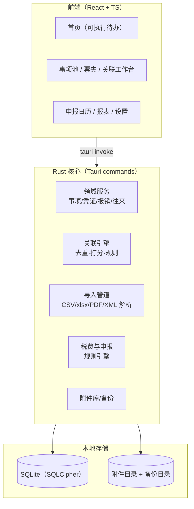

> ⚠️ **状态说明（2026-10-26）**：本文是 2026-10-11 的开工方案，仅作历史参考。
> 其中「Node 数据层 / SQLCipher 预留 / 迁移框架 / 单实例锁 / PRD v1.8 引用」等描述与当前实现不一致；
> **当前真实架构、功能清单与缺口请看 [产品与技术现状.md](产品与技术现状.md)**。

# 自然拾光记账客户端 · 技术方案（v1.0）

> 对应 PRD：《自然拾光记账客户端-产品设计文档.md》v1.8
> 日期：2026-10-11 ｜ 状态：开工依据

## 1. 范围与目标

本方案覆盖**可立即动工的地基**：数据层（建库/迁移/加密/备份）、导入管道骨架、关联引擎核心算法、Tauri 应用壳。按 PRD 分期，首批交付对齐 **Phase 1（基座+关联引擎）**；2a/2b/3 的模块在架构上预留位但不实现。

**验收锚点（对 PRD Phase 1）**：Excel 迁移四勾稽通过、三入口录入、关联引擎出两个清单、缺票处置简版、申报日历提醒、备份/导出。

## 2. 总体架构



- **桌面壳**：Tauri 2.x（Rust 后端 + WebView 前端）；前端 React + TypeScript + Vite。
- **数据**：SQLite 单文件（加密 SQLCipher，一期可先落盘后加密迁移）；附件为本地目录树（PRD §5.12）。
- **AI/授权/网关**：独立轨道（PRD §5.18/5.19），客户端侧只留适配器接口与开关，**不阻塞 Phase 1**。
- **进程模型**：单实例互斥锁（PRD I12）；备份走 SQLite online backup API。

## 3. 模块划分与目录结构

```
zrsj-bookkeeper/
├─ docs/                  # 技术方案、接口契约
├─ db/
│  ├─ schema.sql          # 基线 DDL（v1，幂等可重放）
│  └─ migrations/         # NNN_name.sql 顺序迁移
├─ src/
│  ├─ db/                 # 数据层（连接、迁移、DAO）
│  │  ├─ schema.sql       # 与 db/schema.sql 同步（运行时内嵌）
│  │  ├─ migrate.mjs      # 迁移执行器
│  │  └─ dao.mjs          # 领域 DAO（Phase 1 表）
│  ├─ domain/             # 纯逻辑（打分、状态机、税费）——可单测
│  ├─ importers/          # bank_csv / invoice_xlsx / invoice_pdf / invoice_xml
│  ├─ tauri/              # Tauri 壳（后续安装 Rust 后启用）
│  └─ ui/                 # React 前端
├─ tests/                 # 冒烟与单元测试（node --test）
└─ package.json
```

**分层纪律**：`domain/` 纯函数（无 IO）→ `db/` 与 `importers/` 只做 IO → `tauri/` 只做胶水。关联引擎打分、税费计算、状态机全部落在 `domain/`，用 node:test 单测锁住（PRD 的验收用例即测试用例）。

## 4. 数据层

- **基线 DDL**：`db/schema.sql`，覆盖 PRD §4 全部实体（COMPANY/ACCOUNT/PARTY/EVENT/VOUCHER/REIMBURSEMENT(_LINE)/PAYROLL/SERVICE_JOB/WORKLOG/WITHHOLD_LEDGER/FILING_TASK/FILING_DRAFT/RULE/LICENSE + 元表 `schema_meta`/`import_batch`/`change_log`）。
- **迁移框架**：`schema_meta(version)` + `db/migrations/NNN_*.sql` 顺序执行、事务化、失败回退（PRD §5.9）。
- **幂等**：`import_batch(file_hash)` 保证重复导入 0 新记录；发票规范化键 `code+no` 唯一。
- **修改留痕**：`change_log(entity, entity_id, before, after, at)`——去重合并/红冲/报销修正全部可撤销。
- **加密**：一期用明文库 + 密钥位预留；接入 SQLCipher 时做 `PRAGMA rekey` 迁移（技术选型备注见 §8）。
- **备份**：`VACUUM INTO` / online backup API 输出到独立目录；导出包 = 库文件 + `attachments/` + 配置 json。

## 5. 关键逻辑契约（domain 层）

### 5.1 关联引擎打分（PRD §5.4）

```
候选：金额差 ≤0.01（硬条件，否则不进候选）
得分 = 金额(≤0.01 ? +50 : -∞) + 户名归一相似(+30) + 日期差≤3天(+20) + 历史同配对(+15)
≥80 自动挂靠 ｜ 40–79 待确认队列 ｜ <40 游离
1:N/N:1：组合求和差 ≤0.01 视为金额命中，组合内加权
手续费特例：|差| ≤5 且方向相反 → 提示拆费用事项
```

户名归一化：去括号内容、「有限公司/科技/（中国）」等后缀，小写化——**仅用于召回**，合并须人工确认。

### 5.2 状态机

- VOUCHER.status: `normal | void | red_offsetted | red_offset_src`（红冲两票模型，原票排除统计）
- EVENT.reimburse_status: `none | in_reimburse | reimbursed`；VOUCHER 同名对齐
- REIMBURSEMENT.status: `draft → submitted → paid`（paid 禁 void，冲销走 refund 事项）
- LICENSE.plan: `trial | monthly | yearly | permanent` + `ai_addon` 位

### 5.3 税费规则（PRD §5.7/5.13，参数外置）

- 增值税：季销 ≤30 万——普票+未开票免征、**专票税额不免**；参数 `threshold=300000`、征收率换算口径
- 企税小微：≤300 万实际税负 5%（2023 年 6/12 号公告，参数含失效日）
- 劳务报酬预扣：三级超额累进（应纳税所得额 = 收入−800 或 ×80%；20/30/40%，速算扣除 0/2000/7000，61 号公告）
- 零星起征点：`config` 可配 300–500（默认 500）

全部落 `domain/tax.js` 纯函数 + 参数表，**测试用例来自第三方复审算例**（如 30000 劳务 → 5200）。

## 6. 接口契约（先定契约后实现）

| 契约 | 载体 | 状态 |
|---|---|---|
| `payroll_sync.v1`（HR 端推工资单） | JSON 文件，键=员工+属期，幂等合并 | 文档先行，实现三期 |
| AI 适配器双模式 | `byo_key` / `hosted`（网关鉴权+计量） | 接口预留，实现三期 |
| 导入器接口 | `parse(file) → ImportBatch{rows[], mapping, warnings[]}` | 一期实现 |
| 规则 RULE | 结构化 `{field,op,value}[]` ≤5 默认可扩展 | 一期实现 |

## 7. 前端骨架（Phase 1 页面）

首页（可执行待办三块）→ 记一笔 / 事项池 / 票夹（一期：列表+详情基础版）/ 关联工作台（清单+确认队列）/ 申报日历 / 设置（公司档案+导入+备份）。UI 遵循 PRD 零术语原则；组件库选轻量方案（Tailwind 或无框架 CSS），**不引入重型组件库**。

## 8. 风险与依赖

| 项 | 说明 |
|---|---|
| Rust 工具链未装 | Tauri 构建前置；先以 Node 数据层+单测推进，Rust 就绪后移植 domain 到 Rust 或经 sidecar 调用 |
| SQLCipher | 一期明文+预留；加密切换时需迁移测试 |
| OFD 解析 | 一期只归档不解析（PRD v1.6） |
| 网络盘/多开 | 单实例锁 + 启动网络盘警告 |

## 9. 里程碑

1. **M1（本次）**：DDL + 迁移框架 + DAO + 打分/税费纯函数 + 冒烟测试 ✅ 即本仓库地基
2. **M2**：导入器（bank CSV 列映射、invoice xlsx）+ 关联引擎跑通 + 两个清单
3. **M3**：Excel 迁移向导 + 备份/导出 + 日历提醒
4. **M4**：Tauri 壳 + 核心页面接通 → Phase 1 验收
